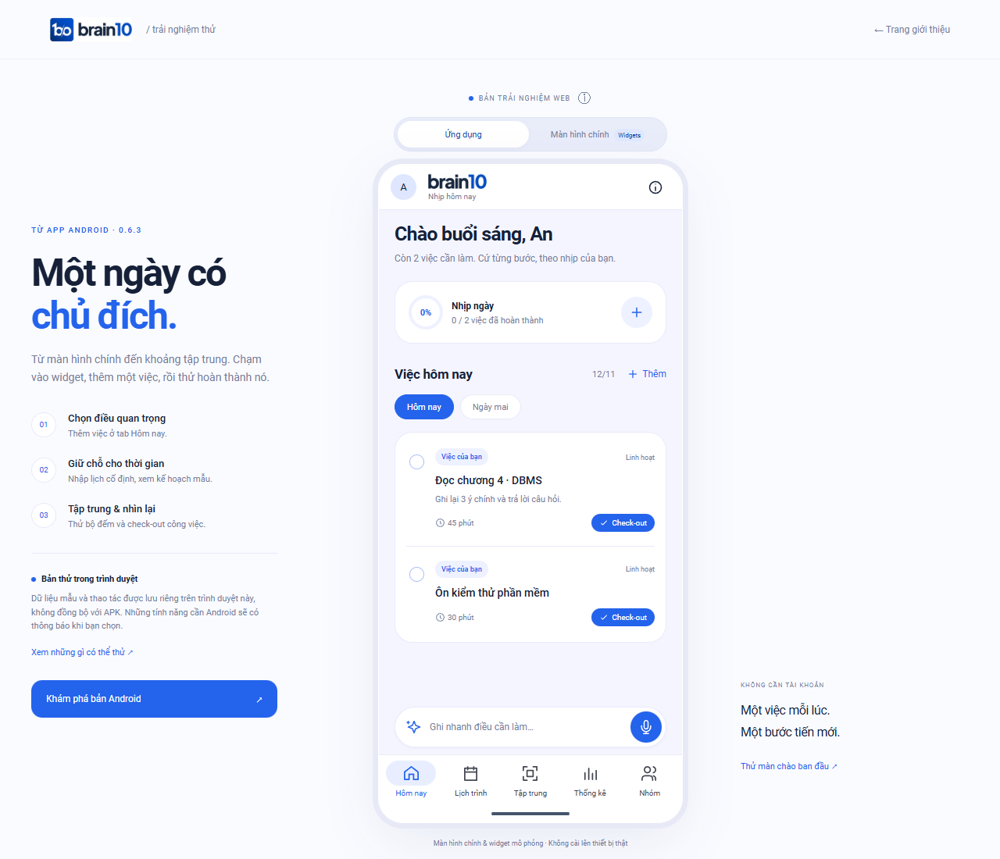

<p align="center">
  
</p>

<h1 align="center">Brain10</h1>

<p align="center">
  <strong>Lên lịch học và làm việc, giữ tập trung và theo dõi tiến độ mỗi ngày.</strong><br>
  Dự án sinh viên tại UTE SV-Startup 2026
</p>

<p align="center">
  <a href="https://brain10-ute-startup2026.sunnyegret35.chatgpt.site/try/"><strong>Thử Brain10 trên trình duyệt</strong></a>
</p>

<p align="center">
  <a href="https://brain10-ute-startup2026.vercel.app/">Website trên Vercel</a><br>
  Địa chỉ thay thế · <a href="https://brain10-ute-startup2026.sunnyegret35.chatgpt.site/">Website trên Sites</a>
</p>

<p align="center">
  <a href="#trải-nghiệm">Trải nghiệm</a> ·
  <a href="#chạy-cục-bộ">Chạy cục bộ</a> ·
  <a href="#cấu-trúc">Cấu trúc</a> ·
  <a href="#kiểm-thử">Kiểm thử</a>
</p>

<p align="center">
  <a href="https://brain10-ute-startup2026.sunnyegret35.chatgpt.site/try/">
    
  </a>
</p>

## Trải nghiệm

Brain10 giúp người dùng chọn việc cần làm, dành thời gian tập trung và ghi lại kết quả. Repo này chứa **trang giới thiệu dự án** và **bản trải nghiệm trên trình duyệt**, dựa trên giao diện Android 0.6.3.

1. Mở bản trải nghiệm và chọn **Dùng hồ sơ mẫu An**.
2. Ở tab **Hôm nay**, thêm một việc hoặc thử **Check-out** một việc có sẵn.
3. Ở tab **Lịch trình**, thêm lịch cố định, xem bảng 1, 2 hoặc 4 tuần và thử kế hoạch ôn tập mẫu.
4. Ở tab **Tập trung**, đặt thời lượng và bắt đầu bộ đếm. Bạn có thể thử hai widget mô phỏng từ chế độ **Màn hình chính**.

Dữ liệu demo được lưu trong trình duyệt. Thống kê thời gian sử dụng thiết bị, hạn chế ứng dụng và widget hệ thống cần app Android. [Chi tiết bản trải nghiệm](DEMO.md) · [Mở màn hình widget](https://brain10-ute-startup2026.sunnyegret35.chatgpt.site/try/?view=launcher)

## Chạy cục bộ

Cần **Node.js 22+** và npm.

```bash
git clone https://github.com/zomboXx/UTE-START-UP-2026.git
cd UTE-START-UP-2026
npm ci
npm start
```

Mở [trang giới thiệu](http://127.0.0.1:4174/) hoặc [bản trải nghiệm](http://127.0.0.1:4174/try/). Biến môi trường `PORT` cho phép đổi cổng.

## Cấu trúc

| Đường dẫn | Nội dung |
| --- | --- |
| [`dist/`](dist/) | Trang giới thiệu, tài nguyên và thông tin bản tải |
| [`dist/try/`](dist/try/) | Giao diện demo, lịch, bộ đếm và widget mô phỏng |
| [`server.mjs`](server.mjs) | Server xem thử cục bộ |
| [`api/plans.mjs`](api/plans.mjs) · [`server/planner.mjs`](server/planner.mjs) | API lập lịch beta, tìm khung giờ và kiểm tra kế hoạch trả về |
| [`tests/`](tests/) · [`test-server/`](test-server/) | Kiểm thử trình duyệt và logic máy chủ |

## Kiểm thử

```bash
npm run check
npm test
npm run test:server
```

`npm run check` kiểm tra cú pháp JavaScript. `npm test` chạy Playwright với Microsoft Edge. Có thể đặt `BRAIN10_TEST_URL` để chạy suite trên một bản triển khai cụ thể. `npm run test:server` kiểm tra handler và logic lập lịch với dữ liệu thử.

## Triển khai và bản cài

<details>
<summary>Cấu hình Vercel</summary>

Import repo với **Framework Preset: Other**, **Root Directory:** thư mục gốc, **Build Command:** để trống và **Output Directory:** `dist`. Cấu hình nằm trong [vercel.json](vercel.json).

Trang giới thiệu và kế hoạch mẫu chạy với HTML, CSS và JavaScript. API beta sử dụng `/api/plans`, có rewrite từ `/v1/plans` cho Android.

</details>

<details>
<summary>Thông tin APK</summary>

[Metadata bản cài](dist/release.json) điều khiển thông tin và nút tải. APK hiện chưa mở tải công khai. Server cục bộ tìm bản thử tại `../mobile/artifacts/brain10-android-debug.apk` hoặc đường dẫn do `BRAIN10_LOCAL_APK` chỉ định.

Khi phát hành, đưa APK đã kiểm chứng lên GitHub Releases và cập nhật phiên bản, kích thước, SHA-256, URL tải và trạng thái kiểm thử thiết bị trong metadata. Kiểm tra điều kiện chấp nhận URL tại [dist/site.js](dist/site.js).

</details>

<details>
<summary>Chạy AI beta</summary>

Đặt `POOL_API_KEY` trong môi trường máy chủ. Luồng AI beta yêu cầu mã thử riêng. Script [prepare-ai-beta.mjs](scripts/prepare-ai-beta.mjs) tạo thông tin dùng thử cho nhóm. Lệnh `node scripts/smoke-ai-live.mjs --run-live` gọi model thật và có thể sử dụng credit.

</details>

## Góp ý

Khi báo lỗi, ghi rõ trình duyệt, màn hình gặp lỗi và các bước tái hiện. [GitHub Issues](https://github.com/zomboXx/UTE-START-UP-2026/issues)

Font Plus Jakarta Sans được phân phối theo [SIL Open Font License](dist/assets/OFL-Jakarta.txt).
